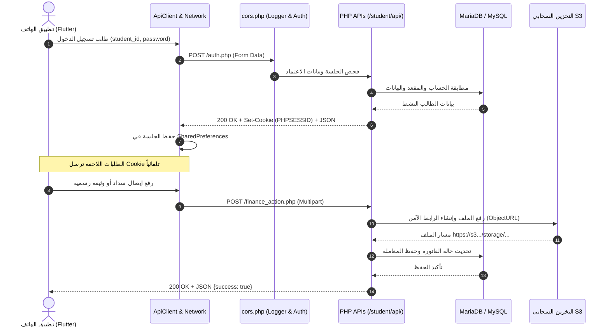
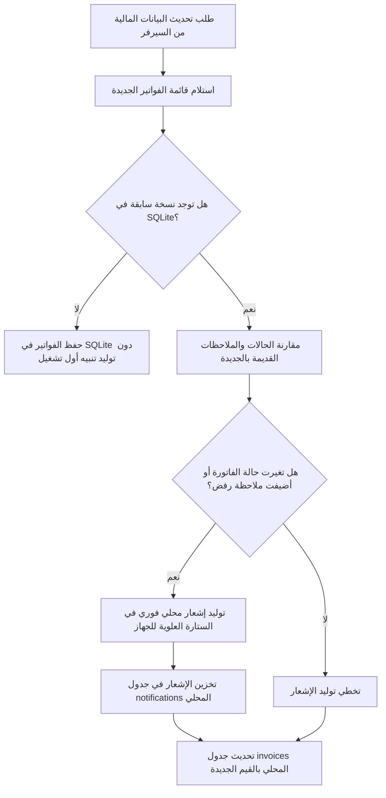

# توثيق واجهات برمجة التطبيقات (API Documentation) - تطبيق طالب جامعة العلوم الصحية (UOHS)

> **الإصدار:** 1.0.0  
> **تاريخ التحديث:** أكتوبر 2026  
> **عنوان الخادم الأساسي (Base URL):** `https://uhos.online/student/api`  
> **بيئة التطوير المحلية:** `http://localhost/uohs/student/api` أو عبر المحاكي `http://10.0.2.2/uohs/student/api`  
> **نظام المصادقة والتفويض:** PHP Session (`PHPSESSID`) عبر ترويسات `Cookie` و `Set-Cookie` مع دعم CORS المتبادل (`Access-Control-Allow-Credentials: true`).

---

## فهرس المحتويات
1. [المعمارية العامة وقواعد الاتصال](#1-المعمارية-العامة-وقواعد-الاتصال)
2. [الترويسات القياسية (HTTP Headers)](#2-الترويسات-القياسية-http-headers)
3. [نظام إدارة الجلسات والأمان (Session Lifecycle)](#3-نظام-إدارة-الجلسات-والأمان-session-lifecycle)
4. [هيكل استجابات النظام الموحد (Unified Response Structure)](#4-هيكل-استجابات-النظام-الموحد-unified-response-structure)
5. [توثيق نقاط الاتصال (API Endpoints)](#5-توثيق-نقاط-الاتصال-api-endpoints)
   - [5.1 وحدة المصادقة والحسابات (Authentication & Registration)](#51-وحدة-المصادقة-والحسابات-authentication--registration)
   - [5.2 وحدة الملف الشخصي والأمان (Profile & Security)](#52-وحدة-الملف-الشخصي-والأمان-profile--security)
   - [5.3 وحدة الشؤون المالية والفواتير (Finance & Invoices)](#53-وحدة-الشؤون-المالية-والفواتير-finance--invoices)
   - [5.4 وحدة الدعم الفني والبلاغات (Support Tickets)](#54-وحدة-الدعم-الفني-والبلاغات-support-tickets)
   - [5.5 وحدة الرعاية والتوجيه الطلابي (Student Affairs & Guidance Chat)](#55-وحدة-الرعاية-والتوجيه-الطلابي-student-affairs--guidance-chat)
   - [5.6 وحدة التنبيهات والإشعارات (Notifications & FCM)](#56-وحدة-التنبيهات-والإشعارات-notifications--fcm)
   - [5.7 جسر بوابة الويب الأكاديمية (SSO WebView Bridge)](#57-جسر-بوابة-الويب-الأكاديمية-sso-webview-bridge)
6. [التخزين السحابي للمرفقات والملفات (AWS S3 / Cloudflare R2)](#6-التخزين-السحابي-للمرفقات-والملفات-aws-s3--cloudflare-r2)
7. [التخزين المحلي والمزامنة اللحظية (Offline SQLite Cache)](#7-التخزين-المحلي-والمزامنة-اللحظية-offline-sqlite-cache)
8. [جدول مصفوفة أنواع البيانات (Data Dictionary & Schemas)](#8-جدول-مصفوفة-أنواع-البيانات-data-dictionary--schemas)

---

## 1. المعمارية العامة وقواعد الاتصال

يعتمد تطبيق Flutter (`uohs_student_app`) في تواصله مع الواجهة الخلفية لجامعة العلوم الصحية (PHP Backend) على بنية RESTful خفيفة ومرنة تدعم:
1. **بروتوكول النقل الآمن:** HTTPS حصراً لضمان تشفير كلمات المرور والبيانات الشخصية ووثائق الإثبات.
2. **صيغ نقل البيانات:**
   - **الطلبات القياسية:** `application/x-www-form-urlencoded` أو Form-Data.
   - **طلبات رفع المستندات:** `multipart/form-data`.
   - **الاستجابات:** `application/json; charset=utf-8`.
3. **التدقيق والمراقبة:** يتم تدوين كافة الطلبات الواردة إلى ملف السجل `api_debug.log` عبر وسيط `cors.php` مع إخفاء كلمات المرور تلقائياً لحماية الخصوصية.



---

## 2. الترويسات القياسية (HTTP Headers)

### 2.1 الترويسات المرسلة من التطبيق (Client Headers)
ترسل فئة `ApiClient` الترويسات التالية في كل طلب:
| اسم الترويسة (Header) | القيمة النمطية | الوصف |
| :--- | :--- | :--- |
| `Accept` | `application/json` | إعلام الخادم بقبول استجابات بصيغة JSON. |
| `X-Requested-With` | `XMLHttpRequest` | منع هجمات CSRF وتحديد هوية العميل البرمجي. |
| `Cookie` | `PHPSESSID=xxxxxx` | معرف جلسة PHP الصالح والمخزن محلياً بعد الدخول. |
| `Content-Type` | `multipart/form-data` | يُرسل تلقائياً في طلبات رفع الملفات مع الـ Boundary. |

### 2.2 ترويسات الخادم (Server Response Headers عبر `cors.php`)
| اسم الترويسة (Header) | القيمة | الوصف |
| :--- | :--- | :--- |
| `Content-Type` | `application/json; charset=utf-8` | ترميز الاستجابة UTF-8 العربي. |
| `Access-Control-Allow-Origin` | اسم النطاق أو `*` | دعم التوافقية والتطوير متعد المنصات. |
| `Access-Control-Allow-Credentials` | `true` | السماح بتبادل ملفات تعريف الارتباط والجلسات. |
| `Access-Control-Allow-Methods` | `GET, POST, OPTIONS, PUT, DELETE` | الطرق المدعومة برمجياً. |
| `Set-Cookie` | `PHPSESSID=...; path=/; HttpOnly` | يصدره الخادم عند الدخول ويحفظه التطبيق فوراً. |

---

## 3. نظام إدارة الجلسات والأمان (Session Lifecycle)

1. **الاستيثاق الأولي:** عند استدعاء `POST /auth.php` بنجاح، يُنشئ الخادم جلسة PHP ويسند متغيراتها:
   - `$_SESSION['user_id']`: المعرف الرقمي في جدول المستخدمين `users`.
   - `$_SESSION['student_id']`: المعرف الرقمي في جدول الطلاب `students`.
   - `$_SESSION['seat_number']`: رقم الجلوس / الرقم الجامعي للطالب.
   - `$_SESSION['role'] = 'student'`: دور المستخدم في النظام.
2. **استخلاص وتخزين الكوكي:** يقوم `ApiClient.dart` باستخراج قيمة `PHPSESSID` من ترويسة الاستجابة `Set-Cookie` وتخزينها في `SharedPreferences` تحت المفتاح `session_cookie`.
3. **الحماية والفحص الدوري:** يتم حماية جميع ملفات الـ API الأخرى بواسطة `ensure_session()` و `require_login_student()`، وفي حال انتهاء الجلسة أو عدم توفرها يُعاد رد الخطأ `{"success": false, "message": "غير مصرح لك بالوصول"}` ويقوم التطبيق بتوجيه المستخدم لشاشة تسجيل الدخول.
4. **تسجيل الخروج:** يتم إرسال طلب إلى `POST /../logout.php` لمسح الجلسة من ذاكرة الخادم (`session_destroy()`) وتفريغ الكوكيز محلياً.

---

## 4. هيكل استجابات النظام الموحد (Unified Response Structure)

تعتمد جميع الاستجابات على المعيار الموحد التالي:

### 4.1 استجابة النجاح (Success Response)
```json
{
  "success": true,
  "message": "نص رسالة النجاح للمستخدم (اختياري)",
  "...": "البيانات الإضافية المخصصة للطلب (profile, invoices, data...)"
}
```

### 4.2 استجابة الفشل أو الخطأ (Error Response)
```json
{
  "success": false,
  "message": "رسالة توضيح سبب الرفض أو الخطأ للواجهة",
  "force_update": false,
  "update_url": "رابط التحديث عند وجود نسخة إجبارية"
}
```

---

## 5. توثيق نقاط الاتصال (API Endpoints)

---

### 5.1 وحدة المصادقة والحسابات (Authentication & Registration)

#### 5.1.1 تسجيل دخول الطالب (Student Login)
- **المسار:** `POST /auth.php`
- **نوع المحتوى:** `application/x-www-form-urlencoded`
- **الصلاحية المطلوبة:** متاح للعامة (Public)

##### المعاملات المرسلة (Request Body):
| المعامل | النوع البرمجي | الحالة | الوصف | مثال |
| :--- | :--- | :--- | :--- | :--- |
| `action` | `String` | إجباري | نوع الإجراء المطلوب | `"login"` |
| `student_id` | `String` | إجباري | الرقم الجامعي / رقم الجلوس | `"12345672026"` |
| `password` | `String` | إجباري | كلمة مرور حساب الطالب | `"Secret@2026"` |
| `app_version` | `String` | اختياري | رقم إصدار التطبيق لفحص التحديثات | `"1.0.0"` |

##### نماذج الاستجابة (JSON Responses):
*استجابة النجاح (200 OK):*
```json
{
  "success": true,
  "message": "تم تسجيل الدخول بنجاح!"
}
```
*ملاحظة هامة:* ترسل الاستجابة ترويسة `Set-Cookie: PHPSESSID=...` التي يتم حفظها لإرفاقها في كافة الطلبات اللاحقة.

*استجابة طلب تحديث إجباري للتطبيق (Force Update Required):*
```json
{
  "success": false,
  "force_update": true,
  "update_url": "https://uhos.online/download/uohs_student_app.apk",
  "message": "يرجى تحديث التطبيق للاستمرار. تم إصدار تحديث جديد ومهم يحتوي على إصلاحات وتحسينات أساسية."
}
```

*استجابة فشل الدخول (خطأ في الاعتمادات):*
```json
{
  "success": false,
  "message": "الرقم الجامعي أو كلمة المرور غير صحيحة."
}
```

---

#### 5.1.2 تسجيل حساب طالب جديد (Student Registration)
- **المسار:** `POST /auth.php`
- **نوع المحتوى:** `application/x-www-form-urlencoded`
- **الصلاحية المطلوبة:** متاح للعامة (Public)

##### المعاملات المرسلة (Request Body):
| المعامل | النوع البرمجي | الحالة | الوصف | مثال |
| :--- | :--- | :--- | :--- | :--- |
| `action` | `String` | إجباري | محدد العملية | `"register"` |
| `full_name` | `String` | إجباري | الاسم الرباعي للطالب | `"محمد أحمد إبراهيم علي"` |
| `student_id` | `String` | إجباري | رقم الجلوس المقترح للطالب | `"240105021"` |
| `national_id` | `String` | إجباري | الرقم الوطني (14 خانة) | `"12345678901234"` |
| `state` | `Integer` | إجباري | معرّف الولاية المسجل بها الطالب | `1` |
| `program` | `Integer` | إجباري | معرّف البرنامج/التخصص الأكاديمي | `5` |
| `password` | `String` | إجباري | كلمة المرور المختارة | `"StudentPass#123"` |

##### نماذج الاستجابة (JSON Responses):
*استجابة النجاح (200 OK):*
```json
{
  "success": true,
  "message": "تم إنشاء حسابك بنجاح! رقمك الجامعي الجديد: 240105021"
}
```

*استجابة تكرار الرقم الجامعي أو الوطني:*
```json
{
  "success": false,
  "message": "هذا الرقم الوطني مسجل مسبقاً في النظام. لديك حساب بالفعل، يرجى الانتقال لصفحة تسجيل الدخول وإدخال بياناتك."
}
```

---

#### 5.1.3 جلب قائمة الولايات المتاحة (Get Active States)
- **المسار:** `POST /auth.php`
- **نوع المحتوى:** `application/x-www-form-urlencoded`
- **الوصف:** جلب الولايات المعتمدة التي تملك برامج فعّالة لملء القائمة المنسدلة في شاشة إنشاء الحساب.

##### المعاملات المرسلة:
```json
{
  "action": "get_states"
}
```

##### نموذج الاستجابة (JSON Response):
```json
{
  "success": true,
  "states": [
    {
      "id": 1,
      "name": "ولاية البحر الأحمر"
    },
    {
      "id": 2,
      "name": "ولاية كسلا"
    },
    {
      "id": 4,
      "name": "ولاية القضارف"
    }
  ]
}
```

---

#### 5.1.4 جلب البرامج الأكاديمية التابعة لولاية (Get State Programs)
- **المسار:** `POST /auth.php`
- **نوع المحتوى:** `application/x-www-form-urlencoded`
- **الوصف:** جلب التخصصات والكليات المتاحة داخل الولاية المختارة (Dynamic Cascade).

##### المعاملات المرسلة:
| المعامل | النوع البرمجي | الحالة | الوصف | مثال |
| :--- | :--- | :--- | :--- | :--- |
| `action` | `String` | إجباري | محدد العملية | `"get_programs"` |
| `state_id` | `Integer / String` | إجباري | معرف الولاية | `"1"` |

##### نموذج الاستجابة (JSON Response):
```json
{
  "success": true,
  "programs": [
    {
      "id": 10,
      "name": "بكالوريوس الطب والجراحة"
    },
    {
      "id": 12,
      "name": "بكالوريوس علوم التمريض"
    },
    {
      "id": 15,
      "name": "بكالوريوس الصيدلة السريرية"
    }
  ]
}
```

---

#### 5.1.5 تسجيل الخروج وإنهاء الجلسة (Logout)
- **المسار:** `POST /../logout.php` (نسبي لمجلد api)
- **الصلاحية المطلوبة:** جلسة نشطة
- **الوصف:** يقوم الخادم بإتلاف الجلسة ومسح المتغيرات (`session_unset()`, `session_destroy()`).

---

### 5.2 وحدة الملف الشخصي والأمان (Profile & Security)

#### 5.2.1 جلب بيانات الملف الشخصي الكاملة (Get Student Profile)
- **المسار:** `POST /profile_action.php`
- **نوع المحتوى:** `application/x-www-form-urlencoded`
- **الصلاحية المطلوبة:** جلسة طالب مسجلة وموثقة (`PHPSESSID`)

##### المعاملات المرسلة:
```json
{
  "action": "get_profile"
}
```

##### نموذج الاستجابة (JSON Response):
```json
{
  "success": true,
  "profile": {
    "id": 142,
    "user_id": 89,
    "username": "240105021",
    "email": "student@uhos.online",
    "seat_number": "240105021",
    "full_name": "محمد أحمد إبراهيم علي",
    "birth_date": "2002-05-14",
    "gender": "M",
    "student_phone": "0912345678",
    "national_id": "12345678901234",
    "current_address": "بورتسودان - حي المطار",
    "permanent_address": "الخرطوم - بحري",
    "guardian_name": "أحمد إبراهيم علي",
    "guardian_phone": "0998765432",
    "guardian_relation": "والد",
    "guardian_job": "مهندس استشاري",
    "certificate_type": "سودانية",
    "certificate_date": "2021-08-01",
    "previous_university": null,
    "previous_admission_date": null,
    "photo_path": "https://pub-xxxx.r2.dev/storage/students/2026/10/photo_142_1729338000.jpg",
    "certificate_result_image_path": "https://pub-xxxx.r2.dev/storage/students/2026/10/cert_142_1729338000.jpg",
    "national_id_image_path": "https://pub-xxxx.r2.dev/storage/students/2026/10/id_142_1729338000.jpg",
    "batch_id": 13,
    "program_id": 10,
    "state_id": 1,
    "application_status": "approved",
    "created_at": "2026-02-15 11:20:00"
  }
}
```

---

#### 5.2.2 تحديث الملف الشخصي ورفع الوثائق (Update Profile & Upload Docs)
- **المسار:** `POST /profile_action.php`
- **نوع المحتوى:** `multipart/form-data`
- **الصلاحية المطلوبة:** جلسة طالب نشطة

##### الحقول النصية (Form Fields):
| الحقل | النوع البرمجي | الحالة | الوصف | مثال |
| :--- | :--- | :--- | :--- | :--- |
| `action` | `String` | إجباري | محدد العملية | `"update_profile"` |
| `birth_date` | `String (YYYY-MM-DD)` | اختياري | تاريخ الميلاد | `"2002-05-14"` |
| `student_phone` | `String` | اختياري | رقم هاتف الطالب النشط | `"0912345678"` |
| `gender` | `String (M/F)` | اختياري | الجنس (M ذكر، F أنثى) | `"M"` |
| `current_address` | `String` | اختياري | عنوان السكن الحالي | `"بورتسودان"` |
| `permanent_address` | `String` | اختياري | عنوان السكن الدائم | `"الخرطوم"` |
| `guardian_name` | `String` | اختياري | اسم ولي الأمر | `"أحمد إبراهيم علي"` |
| `guardian_phone` | `String` | اختياري | رقم هاتف ولي الأمر | `"0998765432"` |
| `guardian_relation` | `String` | اختياري | صلة القرابة (والد، والدة، أخ...) | `"والد"` |
| `guardian_job` | `String` | اختياري | وظيفة / عمل ولي الأمر | `"مهندس"` |
| `certificate_type` | `String` | اختياري | نوع الشهادة الثانوية | `"سودانية"` |
| `certificate_date` | `String (YYYY-MM)` | اختياري | سنة وشهر الحصول على الشهادة | `"2021-08"` |
| `previous_university` | `String` | اختياري | اسم الجامعة السابقة إن وجدت | `"جامعة بحري"` |
| `previous_admission_date` | `String (YYYY-MM-DD)` | اختياري | تاريخ القبول السابق | `"2020-09-01"` |

##### الملفات المرفقة (Multipart Files):
| المفتاح (File Key) | الأنواع المسموحة | الحجم الأقصى | الوصف |
| :--- | :--- | :--- | :--- |
| `photo` | `jpg, jpeg, png` | 5MB | الصورة الشخصية الرسمية للطالب |
| `cert_photo` | `jpg, jpeg, png, pdf` | 10MB | صورة الشهادة الثانوية أو كشف الدرجات |
| `id_photo` | `jpg, jpeg, png, pdf` | 10MB | صورة إثبات الهوية (الرقم الوطني / الجواز) |

##### نموذج الاستجابة (JSON Response):
```json
{
  "success": true,
  "message": "تم حفظ البيانات والوثائق بنجاح! شكراً لك."
}
```

---

#### 5.2.3 تحديث إعدادات الأمان (Update Security Settings)
- **المسار:** `POST /profile_action.php`
- **نوع المحتوى:** `application/x-www-form-urlencoded`
- **الوصف:** تحديث البريد الإلكتروني وكلمة المرور المشفرة للطالب.

##### المعاملات المرسلة:
| المعامل | النوع البرمجي | الحالة | الوصف | مثال |
| :--- | :--- | :--- | :--- | :--- |
| `action` | `String` | إجباري | محدد العملية | `"update_security"` |
| `email` | `String (Email)` | اختياري | البريد الإلكتروني الجديد | `"student24@gmail.com"` |
| `password` | `String` | اختياري | كلمة المرور الجديدة للتشفير بـ Bcrypt | `"NewPassword@2026"` |

##### نماذج الاستجابة:
*استجابة النجاح:*
```json
{
  "success": true,
  "message": "تم تحديث بيانات الأمان بنجاح!"
}
```
*استجابة البريد مستخدم مسبقاً:*
```json
{
  "success": false,
  "message": "هذا البريد مستخدم مسبقاً!"
}
```

---

### 5.3 وحدة الشؤون المالية والفواتير (Finance & Invoices)

#### 5.3.1 جلب البيانات المالية والفواتير والأقساط (Get Financial Records)
- **المسار:** `POST /finance_action.php`
- **نوع المحتوى:** `application/x-www-form-urlencoded`
- **الصلاحية المطلوبة:** جلسة طالب نشطة

##### المعاملات المرسلة:
```json
{
  "action": "get_financials"
}
```

##### نموذج الاستجابة الشامل (JSON Response):
```json
{
  "success": true,
  "invoices": [
    {
      "id": 305,
      "invoice_number": "INV-2026-00452",
      "title": "رسوم التسجيل للفصل الدراسي الأول 2026/2027",
      "total_amount": "250000.00",
      "status": "payment_requests",
      "created_at": "2026-10-10 09:30:00",
      "receipt_path": "https://pub-xxxx.r2.dev/storage/payment_receipts/2026/10/receipt_inv_305_1729339200.jpg",
      "purpose": "registration_fees",
      "fee_categories_json": "[{\"id\":1,\"name\":\"رسوم تسجيل\"},{\"id\":2,\"name\":\"رسوم بطاقة جامعية\"}]",
      "rejection_note": "",
      "payment_reference": "TXN987654321",
      "payment_bank_info": "بنك الخرطوم - بنكك",
      "category_names": "رسوم تسجيل، رسوم بطاقة جامعية"
    },
    {
      "id": 280,
      "invoice_number": "INV-2026-00210",
      "title": "رسوم دراسية - القسط الثاني",
      "total_amount": "500000.00",
      "status": "unpaid",
      "created_at": "2026-09-01 12:00:00",
      "receipt_path": null,
      "purpose": "tuition",
      "fee_categories_json": null,
      "rejection_note": "الصورة المرفقة غير واضحة، يرجى إعادة إرفاق إشعار بنكك الرسمي مع إظهار الرقم المرجعي كاملاً.",
      "payment_reference": "",
      "payment_bank_info": "",
      "category_names": ""
    }
  ],
  "installments": [
    {
      "id": 12,
      "title": "القسط الدراسي الأول",
      "amount": "250000.00",
      "due_date": "2026-11-15",
      "status": "pending"
    }
  ],
  "banks": [
    {
      "id": 1,
      "bank_name": "بنك الخرطوم (تطبيق بنكك)",
      "account_number": "1845920"
    },
    {
      "id": 2,
      "bank_name": "بنك فيصل الإسلامي (فوري)",
      "account_number": "892015"
    },
    {
      "id": 3,
      "bank_name": "بنك أم درمان الوطني (أوكاش)",
      "account_number": "443210"
    }
  ],
  "summary": {
    "required": "500,000.00",
    "paid": "250,000.00",
    "in_progress": "250,000.00"
  }
}
```

##### حالات الفواتير في النظام (`status`):
- `unpaid`: فاتورة مستحقة ولم يتم إرسال إشعار سداد لها (أو تم رفض الإشعار السابق).
- `payment_requests` أو `In progress`: تم إرسال إشعار التحويل وهي حالياً قيد المراجعة والتدقيق المالي من قبل الإدارة المالية.
- `paid`: فاتورة مسددة بالكامل ومعتمدة مالياً.
- `partial`: مسددة جزئياً.

---

#### 5.3.2 إرسال وتحديث إشعار التحويل البنكي (Upload Payment Receipt)
- **المسار:** `POST /finance_action.php`
- **نوع المحتوى:** `multipart/form-data`
- **الصلاحية المطلوبة:** جلسة طالب نشطة

##### الحقول النصية (Form Fields):
| الحقل | النوع البرمجي | الحالة | الوصف | مثال |
| :--- | :--- | :--- | :--- | :--- |
| `action` | `String` | إجباري | محدد العملية | `"upload_receipt"` |
| `invoice_id` | `Integer / String` | إجباري | معرّف الفاتورة المطلوب سدادها | `"305"` |
| `transaction_number` | `String` | إجباري | رقم العملية البنكية / الرقم المرجعي | `"TXN987654321"` |
| `bank_name` | `String` | إجباري | اسم البنك أو تطبيق التحويل | `"بنك الخرطوم (تطبيق بنكك)"` |

##### الملفات المرفقة (Multipart Files):
| المفتاح (Key) | الأنواع المسموحة | الحالة | الوصف |
| :--- | :--- | :--- | :--- |
| `receipt` | `jpg, jpeg, png, pdf` | اختياري عند تعديل طلب قائم، إجباري عند الرفع لأول مرة | صورة أو مستند PDF لإشعار التحويل البنكي |

##### نماذج الاستجابة:
*استجابة النجاح:*
```json
{
  "success": true,
  "message": "تم رفع وتأكيد استلام الإشعار البنكي بنجاح. هو الآن قيد مراجعة دائرة المحاسبة!"
}
```

*استجابة منع تكرار الرقم المرجعي (Duplicate Fraud Prevention):*
```json
{
  "success": false,
  "message": "لا يمكن الدفع بنفس الإشعار مرتين! هذا الرقم مسجل مسبقاً."
}
```

---

### 5.4 وحدة الدعم الفني والبلاغات (Support Tickets)

#### 5.4.1 استعراض تذاكر الدعم الفني الخاصة بالطالب (Get Tickets)
- **المسار:** `GET /get_support_tickets.php`
- **نوع المحتوى:** `application/json`
- **الصلاحية المطلوبة:** جلسة طالب نشطة

##### المعاملات المرسلة: لا توجد (يتم استخراج هوية الطالب تلقائياً من الجلسة).

##### نموذج الاستجابة (JSON Response):
```json
{
  "success": true,
  "data": [
    {
      "id": 48,
      "title": "تعذر تنزيل البطاقة الجامعية",
      "desc": "أواجه مشكلة في توليد باركود البطاقة من قسم المستندات، تظهر رسالة خطأ بالرقم الجامعي.",
      "date": "2026-10-18",
      "status": "pending",
      "status_ar": "قيد الإجراء",
      "feedback": null
    },
    {
      "id": 42,
      "title": "تعديل الاسم في الشهادة الثانوية",
      "desc": "يوجد خطأ إملائي في اللقب المسجل في ملفي الشخصي.",
      "date": "2026-10-12",
      "status": "rejected",
      "status_ar": "مرفوض",
      "feedback": "يرجى إرفاق صورة الرقم الوطني وجواز السفر لمطابقة اللقب رسمياً."
    },
    {
      "id": 35,
      "title": "استعادة كلمة المرور للبوابة",
      "desc": "تم حل المشكلة وتعيين كلمة مرور مؤقتة عبر البريد.",
      "date": "2026-09-20",
      "status": "accepted",
      "status_ar": "مقبول",
      "feedback": "تم التفعيل بنجاح."
    }
  ]
}
```

---

#### 5.4.2 إنشاء أو تعديل تذكرة دعم فني (Create / Edit Support Ticket)
- **المسار:** `POST /save_support_ticket.php`
- **نوع المحتوى:** `multipart/form-data`
- **الصلاحية المطلوبة:** جلسة طالب نشطة

##### الحقول النصية (Form Fields):
| الحقل | النوع البرمجي | الحالة | الوصف | مثال |
| :--- | :--- | :--- | :--- | :--- |
| `title` | `String` | إجباري | عنوان المشكلة أو البلاغ | `"مشكلة في سداد القسط الثاني"` |
| `desc` | `String` | إجباري | الشرح التفصيلي للمشكلة | `"تم خصم المبلغ من الحساب ولم يتم تحديث الفاتورة..."` |
| `edit_id` | `Integer / String` | اختياري | معرّف التذكرة المرفوضة في حال إعادة إرسالها وتعديلها | `"42"` |

##### الملف المرفق (Multipart File):
| المفتاح (Key) | الأنواع المسموحة | الحجم الأقصى | الوصف |
| :--- | :--- | :--- | :--- |
| `attachment` | `jpg, jpeg, png, pdf, doc, docx` | 10MB | لقطة شاشة للخطأ أو مستند توضيحي |

##### قواعد العمل والتحقق (Business Logic):
- لا يسمح النظام بفتح تذكرة جديدة إذا كان لدى الطالب تذكرة أخرى بحالة `قيد الإجراء` (`pending`).
- التذاكر المرفوضة (`rejected`) فقط هي القابلة لإعادة التعديل باستخدام `edit_id`.

##### نماذج الاستجابة:
*استجابة النجاح:*
```json
{
  "success": true,
  "message": "تم إرسال الطلب بنجاح"
}
```

*استجابة وجود تذكرة مفتوحة بالفعل:*
```json
{
  "success": false,
  "message": "لديك طلب قيد الإجراء حالياً."
}
```

---

### 5.5 وحدة الرعاية والتوجيه الطلابي (Student Affairs & Guidance Chat)

#### 5.5.1 جلب قائمة طلبات الرعاية والتوجيه (Get Affairs Requests)
- **المسار:** `GET /get_affairs_requests.php`
- **نوع المحتوى:** `application/json`
- **الصلاحية المطلوبة:** جلسة طالب نشطة

##### نموذج الاستجابة (JSON Response):
```json
{
  "success": true,
  "data": [
    {
      "id": 15,
      "title": "طلب استشارة إرشاد أكاديمي ونفسي",
      "request_type": "academic_guidance",
      "status": "قيد الدراسة",
      "created_at_str": "2026-10-15",
      "last_activity_at": "2026-10-19 11:45:00"
    },
    {
      "id": 8,
      "title": "طلب تقسيط استثنائي للرسوم الدراسية",
      "request_type": "social_support",
      "status": "جديد",
      "created_at_str": "2026-10-01",
      "last_activity_at": "2026-10-01 14:20:00"
    }
  ]
}
```

---

#### 5.5.2 فتح طلب رعاية وتوجيه جديد (Create Affairs Request)
- **المسار:** `POST /create_affairs_request.php`
- **نوع المحتوى:** `application/x-www-form-urlencoded`
- **الصلاحية المطلوبة:** جلسة طالب نشطة

##### المعاملات المرسلة:
| المعامل | النوع البرمجي | الحالة | الوصف | مثال |
| :--- | :--- | :--- | :--- | :--- |
| `title` | `String` | إجباري | موضوع الطلب | `"طلب استشارة إرشاد أكاديمي"` |
| `type` | `String` | إجباري | تصنيف الطلب (`academic`, `social`, `medical`, `other`) | `"academic_guidance"` |
| `desc` | `String` | إجباري | الرسالة الأولى التي تفتتح المحادثة | `"السلام عليكم، أرغب في مقابلة المرشد الأكاديمي..."` |

##### نموذج الاستجابة (JSON Response):
```json
{
  "success": true,
  "message": "تم فتح الطلب بنجاح",
  "request_id": 16
}
```

---

#### 5.5.3 جلب سجل المحادثة لطلب معين (Get Affairs Chat History)
- **المسار:** `GET /get_affairs_chat.php`
- **معاملات الرابط (Query Parameters):**
  - `request_id` (إجباري): معرّف طلب الرعاية (مثال: `?request_id=16`)

##### نموذج الاستجابة الشامل (JSON Response):
```json
{
  "success": true,
  "status": "قيد الدراسة",
  "data": [
    {
      "id": 101,
      "sender_type": "student",
      "message_text": "السلام عليكم، أرغب في مقابلة المرشد الأكاديمي بخصوص إعادة امتحان مادة الكيمياء الحيوية.",
      "attachment_path": null,
      "attachment_type": null,
      "time_str": "10:15 AM"
    },
    {
      "id": 102,
      "sender_type": "staff",
      "message_text": "وعليكم السلام ورحمة الله، تم استلام طلبك يا بني. يرجى الاطلاع على الجدول المرفق.",
      "attachment_path": "https://pub-xxxx.r2.dev/storage/affairs_guidance/2026/10/chat_staff_table.pdf",
      "attachment_type": "document",
      "time_str": "11:20 AM"
    },
    {
      "id": 103,
      "sender_type": "student",
      "message_text": "تسجيل صوتي يشرح العذر الطبي بالتفصيل.",
      "attachment_path": "https://pub-xxxx.r2.dev/storage/affairs_guidance/2026/10/chat_voice_record_16.mp3",
      "attachment_type": "audio",
      "time_str": "11:35 AM"
    }
  ]
}
```

##### أنواع المرفقات التلقائية في الشات (`attachment_type`):
- `image`: امتدادات الصور (`jpg, jpeg, png, gif`).
- `document`: امتدادات المستندات والبي دي إف (`pdf, doc, docx, xls, xlsx, txt`).
- `audio`: التسجيلات الصوتية وملاحظات الصوت (`mp3, webm, wav, ogg`).

---

#### 5.5.4 إرسال رسالة شات جديدة (Send Chat Message & Attachments)
- **المسار:** `POST /send_affairs_message.php`
- **نوع المحتوى:** `multipart/form-data`
- **الصلاحية المطلوبة:** جلسة طالب نشطة ومالك الطلب

##### الحقول النصية:
| الحقل | النوع البرمجي | الحالة | الوصف | مثال |
| :--- | :--- | :--- | :--- | :--- |
| `request_id` | `Integer / String` | إجباري | معرّف طلب الرعاية | `"16"` |
| `message` | `String` | اختياري عند إرسال مرفق | نص الرسالة | `"تم إرفاق العذر الطبي الرسمي مختوم من المستشفى."` |

##### الملف المرفق:
| المفتاح (Key) | الأنواع المسموحة | الوصف |
| :--- | :--- | :--- |
| `attachment` | صور، مستندات، أو تسجيل صوتي | مرفق المحادثة المباشر |

##### نموذج الاستجابة (JSON Response):
```json
{
  "success": true,
  "message": "تم الإرسال"
}
```

---

### 5.6 وحدة التنبيهات والإشعارات (Notifications & FCM)

#### 5.6.1 جلب التنبيهات الخاصة بالطالب (Get Notifications)
- **المسار:** `POST /notifications_action.php`
- **نوع المحتوى:** `application/x-www-form-urlencoded`
- **الصلاحية المطلوبة:** جلسة طالب نشطة

##### المعاملات المرسلة:
```json
{
  "action": "get_notifications"
}
```

##### نموذج الاستجابة (JSON Response):
```json
{
  "success": true,
  "unread_count": 2,
  "notifications": [
    {
      "id": 89,
      "student_id": 142,
      "title": "اعتماد سداد الفاتورة",
      "message": "تم تأكيد واعتماد سداد الفاتورة رقم #INV-2026-00452 بنجاح من الدائرة المالية.",
      "type": "invoice",
      "is_read": 0,
      "is_received": 1,
      "created_at": "2026-10-19 12:30:15",
      "received_at": "2026-10-19 12:30:45"
    },
    {
      "id": 74,
      "student_id": 142,
      "title": "إعلان بدء امتحانات الملاحق",
      "message": "نحيطكم علماً بأن امتحانات الدور الثاني ستبدأ في مطلع الشهر القادم.",
      "type": "academic",
      "is_read": 1,
      "is_received": 1,
      "created_at": "2026-10-15 08:00:00",
      "received_at": "2026-10-15 08:05:00"
    }
  ]
}
```

---

#### 5.6.2 تحديد الإشعار كمقروء (Mark Notification as Read)
- **المسار:** `POST /notifications_action.php`
- **نوع المحتوى:** `application/x-www-form-urlencoded`

##### المعاملات المرسلة:
| المعامل | النوع البرمجي | الحالة | الوصف | مثال |
| :--- | :--- | :--- | :--- | :--- |
| `action` | `String` | إجباري | محدد العملية | `"mark_as_read"` |
| `notification_id` | `String / Integer` | اختياري | معرّف الإشعار (إذا تُرك فارغاً تصبح كافة الإشعارات مقروءة) | `"89"` |

##### نموذج الاستجابة (JSON Response):
```json
{
  "success": true,
  "message": "تم تحديث حالة القراءة."
}
```

---

#### 5.6.3 تأكيد استلام الإشعار في هاتف الطالب (Mark as Received / ACK)
- **المسار:** `POST /notifications_action.php`
- **نوع المحتوى:** `application/x-www-form-urlencoded`
- **الوصف:** يُستدعى تلقائياً من خلفية تطبيق Flutter فور وصول إشعار Firebase (`FCM background handler`) لتسجيل وقت الاستلام الفعلي في السيرفر لأغراض التدقيق.

##### المعاملات المرسلة:
```json
{
  "action": "mark_as_received",
  "notification_id": "89"
}
```

##### نموذج الاستجابة (JSON Response):
```json
{
  "success": true,
  "message": "تم تحديث حالة الاستلام بنجاح."
}
```

---

#### 5.6.4 تحديث رمز Firebase لجهاز الطالب (Update FCM Device Token)
- **المسار:** `POST /notifications_action.php`
- **نوع المحتوى:** `application/x-www-form-urlencoded`
- **الوصف:** يُستدعى عند تثبيت التطبيق لأول مرة أو تجدد الرمز لتوجيه الرسائل اللحظية لجهاز الطالب تحديداً.

##### المعاملات المرسلة:
| المعامل | النوع البرمجي | الحالة | الوصف |
| :--- | :--- | :--- | :--- |
| `action` | `String` | إجباري | `"update_fcm_token"` |
| `fcm_token` | `String` | إجباري | رمز التسجيل الصادر من Firebase Cloud Messaging |

##### نموذج الاستجابة (JSON Response):
```json
{
  "success": true,
  "message": "تم تحديث رمز الإشعارات بنجاح."
}
```

---

### 5.7 جسر بوابة الويب الأكاديمية (SSO WebView Bridge)

لدمج الشاشات الكبيرة مثل (التقويم الأكاديمي، كشوف الدرجات والنتائج) ضمن التطبيق دون إرهاق الطالب بتسجيل الدخول مرتين، يوفر النظام آلية الربط الأحادي (Single Sign-On):

#### الروابط المستهدفة:
1. **التقويم الجامعي:** `https://uhos.online/student/calendar.php`
2. **التحصيل الأكاديمي والنتائج:** `https://uhos.online/student/academic.php`

#### المعاملات الممررة في الرابط (Query Parameters):
| المعامل | النوع البرمجي | الوصف |
| :--- | :--- | :--- |
| `student_user_id` | `String` | الرقم الجامعي للطالب لتأكيد الملكية. |
| `session_token` | `String` | رمز جلسة PHP النشط المحمي. |
| `auth_source` | `String` | قيمة ثابتة `"mobile_app"` لتهيئة الواجهة متجاوبة للهاتف. |

#### الترويسات المحقونة داخل `WebView`:
```http
Cookie: PHPSESSID=<SessionCookie>; student_user_id=<StudentId>
Authorization: Bearer <SessionCookie>
X-Requested-With: XMLHttpRequest
X-UHS-Student-Session: <StudentId>
```

---

## 6. التخزين السحابي للمرفقات والملفات (AWS S3 / Cloudflare R2)

يتم تخزين كافة المرفقات المرفوعة من التطبيق في مساحة سحابية متوافقة مع Amazon S3 بنظام الدلائل المؤرخة:

### بنية مجلدات التخزين (Object Keys Architecture):
1. **وثائق وصور الطلاب الشخصية:**  
   `storage/students/{YYYY}/{MM}/photo_{student_id}_{timestamp}.{ext}`  
   `storage/students/{YYYY}/{MM}/cert_{student_id}_{timestamp}.{ext}`  
   `storage/students/{YYYY}/{MM}/id_{student_id}_{timestamp}.{ext}`
2. **إيصالات السداد والتحويل البنكي:**  
   `storage/payment_receipts/{YYYY}/{MM}/receipt_inv_{invoice_id}_{timestamp}.{ext}`
3. **تذاكر الدعم الفني:**  
   `storage/support_tickets/{YYYY}/{MM}/ticket_{unique_id}.{ext}`
4. **مرفقات وتوجيهات الشات الصوتي والمستندات:**  
   `storage/affairs_guidance/{YYYY}/{MM}/chat_{unique_id}.{ext}`

---

## 7. التخزين المحلي والمزامنة اللحظية (Offline SQLite Cache)

يحتوي التطبيق على قاعدة بيانات محلية مدمجة `uohs_student.db` توفر ميزتين أساسيتين:
1. **العمل دون اتصال بالإنترنت (Offline First):** فتح الفواتير والإشعارات السابقة فوراً.
2. **محرك المقارنة وتوليد التنبيهات اللحظية (Local Diff Engine):** عند استدعاء `fetchFinancials()`، يقوم التطبيق بمقارنة حالة الفواتير في السيرفر مع المخزنة في SQLite؛ فإذا تغيرت الحالة (مثلاً من `payment_requests` إلى `paid`) أو أُضيفت ملاحظة رفض جديدة (`rejection_note`)، يقوم التطبيق تلقائياً بتوليد إشعار فوري في درج تنبيهات الهاتف (Android Notification Bar).



---

## 8. جدول مصفوفة أنواع البيانات (Data Dictionary & Schemas)

### 8.1 كائن الطالب (Student Profile Object)
```typescript
interface StudentProfile {
  id: number;                          // المعرف الرقمي الأساسي للطالب
  user_id: number;                     // المعرف المرتبط في جدول المستخدمين
  username: string;                    // اسم المستخدم (يطابق رقم الجلوس)
  email: string | null;                // البريد الإلكتروني للطالب
  seat_number: string;                 // رقم الجلوس / الرقم الجامعي
  full_name: string;                   // الاسم الرباعي
  birth_date: string;                  // تاريخ الميلاد (YYYY-MM-DD)
  gender: "M" | "F";                   // النوع (M: ذكر، F: أنثى)
  student_phone: string;               // هاتف الطالب
  national_id: string;                 // الرقم الوطني
  current_address: string | null;      // العنوان الحالي
  permanent_address: string | null;    // العنوان الدائم
  guardian_name: string | null;        // اسم ولي الأمر
  guardian_phone: string | null;       // هاتف ولي الأمر
  guardian_relation: string | null;     // صلة القرابة
  guardian_job: string | null;         // مهنة ولي الأمر
  certificate_type: string | null;     // نوع الشهادة الثانوية
  certificate_date: string | null;     // تاريخ الحصول عليها
  photo_path: string | null;           // رابط الصورة الشخصية
  certificate_result_image_path: string | null; // رابط صورة الشهادة
  national_id_image_path: string | null;        // رابط إثبات الهوية
  program_id: number;                  // معرف البرنامج الأكاديمي
  state_id: number;                    // معرف الولاية
  batch_id: number;                    // معرف الدفعة الأكاديمية
  application_status: "pending" | "approved" | "rejected";
}
```

### 8.2 كائن الفاتورة المالية (Invoice Object)
```typescript
interface Invoice {
  id: number;                          // معرّف الفاتورة
  invoice_number: string;              // الكود المرجعي للفاتورة (مثال: INV-2026-00452)
  title: string;                       // مسمى الفاتورة والرسوم
  total_amount: string;                // القيمة المالية بالجنيه السوداني كـ Decimal
  status: "unpaid" | "payment_requests" | "paid" | "partial"; // حالة السداد
  rejection_note: string;              // ملاحظات التدقيق المالي في حال الرفض
  receipt_path: string | null;         // رابط صورة إيصال السداد المحفوظ في S3
  payment_reference: string;           // الرقم المرجعي للتحويل البنكي
  payment_bank_info: string;           // اسم البنك المستخدم في التحويل
  category_names: string;              // بنود الرسوم المفصلة بالعربية
  created_at: string;                  // تاريخ إصدار الفاتورة
}
```

### 8.3 كائن الإشعار (Notification Object)
```typescript
interface AppNotification {
  id: string;                          // معرّف الإشعار (فريد)
  title: string;                       // عنوان الإشعار
  message: string;                     // نص ومحتوى الإشعار
  created_at: string;                  // وقت وتاريخ الإرسال
  is_read: 0 | 1;                      // هل تمت القراءة (0: غير مقروء، 1: مقروء)
  is_received: 0 | 1;                  // هل تم تأكيد وصوله لجهاز الهاتف
  type: "general" | "invoice" | "academic" | "support"; // تصنيف الإشعار
}
```

---

*تم إعداد هذا التوثيق ليكون المرجع التقني الشامل والمعياري لكافة عمليات الربط والتطوير والتكامل المستقبلي لمنظومة جامعة العلوم الصحية.*
